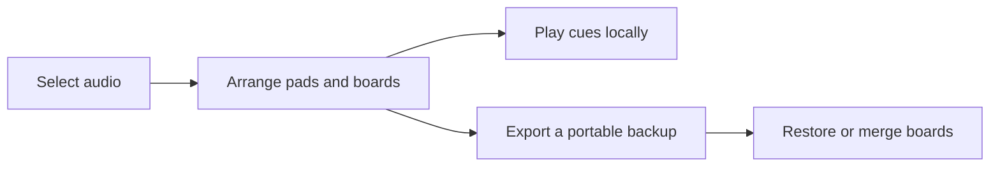

# CueGrid

**A local cue board for live shows, streams, tabletop sessions, and presentations.**

CueGrid keeps short audio cues in a fast, touch-friendly grid. Add your own files, arrange them into boards, assign optional keys, set individual volume and loop behavior, and stop every sound instantly. Your audio stays in this browser profile; there is no account or upload service.

## Use

Open `index.html` in a modern browser, or visit the hosted Pages app. Add MP3, WAV, OGG, or other audio supported by your browser. Click a pad or press its displayed shortcut while the CueGrid tab is focused. Use **Stop all** to silence all active cues. Boards and audio are stored locally in IndexedDB. Use **Backup** to save a portable `.cuegrid.json` library file and **Restore** to replace the current library after confirming. Backups include board settings and the audio itself. The app checks backup format and size before replacing local data. On the hosted app, a service worker caches the app shell for later offline use; open it once online first.

Use **Add pack** to merge boards from a CueGrid backup into your current library without replacing existing boards.

Keyboard shortcuts only work while this page has focus. This web edition does not provide system-wide hotkeys, virtual microphone routing, or OBS integration.

## Included

- Multiple named boards with 24 pads each.
- Full library backup and restore, including audio files (up to 50 MiB total; 25 MiB per audio file).
- Local audio import, rename, remove, per-pad volume and loop.
- Simultaneous cue playback, pad activity state, and a global stop control.
- Focus-aware keyboard shortcuts and large touch targets.
- No third-party libraries, remote fonts, trackers, or analytics. The hosted service worker fetches and caches only CueGrid's own static app files.
- The hosted app can continue loading offline after its first successful visit.

## Privacy and storage

Audio files and board settings remain in the browser's local IndexedDB database. Clearing site data removes them. Make a fresh backup before moving browsers or clearing site data. CueGrid does not read files until you select them and does not transmit them. The offline cache stores only app files, not the sound library. Restoring a backup replaces the current library after a confirmation prompt.

## Support / Pro Version

CueGrid is free and open source under MIT. Optional support: [Buy Me a Coffee](https://buymeacoffee.com/azizazimov8) · [Boosty](https://boosty.to/azimovian).

The **CueGrid Stream Starter Pack** adds ready-to-use original cue boards and audio clips. [Get the pack on Boosty](https://boosty.to/azizazimov/posts/1d4a67a2-a1b8-477d-96f1-c92fd0c3f8c0).

You can also send a supported asset to one of these public receive addresses:

| Network | Asset standard | Address |
|---|---|---|
| Bitcoin | BTC | `bc1qn75pj4n7gyl2k5kf2f97elvyenz52q6nn2g30u` |
| Tron | TRC-20 | `TCBSy38X57hA6w2onJcxom24x1febc1mP1` |
| BNB Smart Chain | BEP-20 | `0xD431a917961E0b086B96D9F72b5C8fF19b19068a` |

Send funds only using the matching network and asset.

## Limits

Keyboard shortcuts work only while the CueGrid tab is focused. This web edition does not provide system-wide hotkeys, virtual microphone routing, or OBS integration. The backup is a JSON file containing base64-encoded audio, so it is larger than the original audio; keep its 70 MiB file-size cap in mind.

## License

MIT. See [LICENSE](LICENSE).
